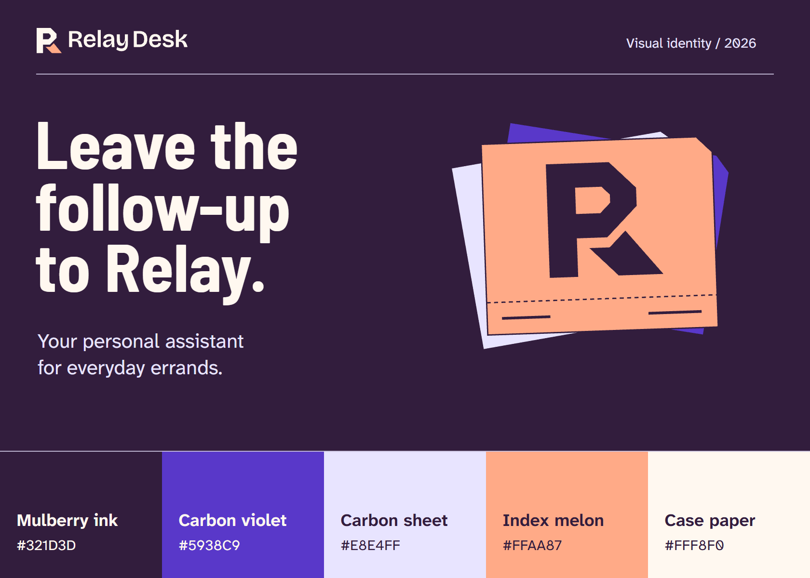

# Relay Desk identity

**Leave the follow-up to Relay.** Relay Desk is a personal chief of staff for everyday admin. Its mark comes from the folded duplicate on a paper receipt. Keep the outcome the owner handed over, the permission they gave and the record that proves what happened close together. The morning briefing demonstrates that principle across a refund, a service visit and a revised bill. [Household experience](docs/experience.md)

The two-page identity board includes the wordmark, palette, typography and a synthetic household briefing. The editable source retains separate text, colour swatches and artwork. [Identity board PDF](docs/brand/identity.pdf) · [Editable identity board](docs/brand/identity.pptx)

## The folded receipt

Two cut shapes form the R. The upright is the face of the receipt and the angled leg is its carbon copy. Use the complete name to introduce the desk. Use the standalone mark when the name is already visible. The wordmark is outlined Bricolage Grotesque SemiBold. Scale the supplied art proportionally to preserve the letterforms and the gap between the two pieces.

| Artwork | Placement | Minimum width |
| --- | --- | ---: |
| [Primary wordmark](docs/brand/wordmark.svg) | Mulberry lettering and violet fold on case paper or carbon sheet | 144 CSS px |
| [Reversed wordmark](docs/brand/wordmark-reversed.svg) | Case paper lettering and melon fold on the included mulberry field | 150 CSS px |
| [Standalone mark](docs/brand/mark.svg) | One-colour mark on a light field. Prefer 24 CSS px in the interface. | 16 CSS px |

Leave one stem width of clear space on every side, equivalent to one quarter of the drawn mark’s height. The reversed wordmark includes this margin. Below the minimum wordmark width, use the standalone mark. Use **Relay Desk** as the accessible name when the artwork identifies the product on its own.

## Paper and Carbon

Paper is the owner’s everyday briefing surface. Carbon is the dark cover, header or focused decision surface. Use an evenly offset under-sheet and one diagonally clipped corner to make an important record recognizable. An index tab names the reason a person needs to look at it.

| Colour | sRGB | Paper | Carbon |
| --- | --- | --- | --- |
| Mulberry ink | `#321D3D` | Reading text, outlines and evidence | Background and type on light controls |
| Case paper | `#FFF8F0` | Background and type on violet | Primary type |
| Carbon violet | `#5938C9` | Action, waiting ring, links and under-sheet | Fold on a light sheet |
| Carbon sheet | `#E8E4FF` | Evidence inset | Secondary type and active controls |
| Index melon | `#FFAA87` | Review tab with mulberry type | Exception label and reversed fold |

| Text and background pair | Contrast ratio |
| --- | ---: |
| Mulberry ink and case paper | 14.46∶1 |
| Mulberry ink and carbon sheet | 12.31∶1 |
| Case paper and carbon violet | 7.04∶1 |
| Carbon violet and carbon sheet | 5.99∶1 |
| Mulberry ink and index melon | 8.23∶1 |

Underline links in prose. Add a separated focus ring in violet on Paper or carbon sheet on Carbon. Use an ink edge wherever the boundary of a pale tab carries meaning. These pairs clear the WCAG AA contrast minimums of 4.5∶1 for normal text and 3∶1 for meaningful graphics. [Text contrast](https://www.w3.org/WAI/WCAG22/Understanding/contrast-minimum.html) · [Non-text contrast](https://www.w3.org/WAI/WCAG22/Understanding/non-text-contrast.html)

## Type and evidence

Set headlines and prominent case outcomes in **Barlow Semi Condensed Bold**. The fixed artwork falls back to Bahnschrift SemiCondensed, Arial Narrow, then sans-serif. Use **Atkinson Hyperlegible Next** for decisions, controls, dates and receipts, with Segoe UI and system sans-serif as fallbacks. Use day–month dates, familiar rupee formatting and tabular numerals where amounts change. [Editable briefing artwork](docs/images/relay-desk-briefing.svg) · [Typeface licenses](docs/brand/font-licenses.txt)

- **Needs your review** belongs on a genuine decision. For the bill, show both amounts, the ₹900 limit and the exact choice in the same view.
- **Waiting for credit** uses an open ring and words naming the missing proof. The merchant’s promise belongs in the history.
- **Provider confirmed** uses a check and the confirmed appointment time. Show calendar sync separately from the provider’s booking record.
- **Unable to check** names the affected source and the last successful read. Keep other delegated outcomes available.

The system should be quiet when the owner has nothing to decide. Reserve motion for a change of state, keep keyboard focus stable, and use text and shape to carry the change under reduced motion.
