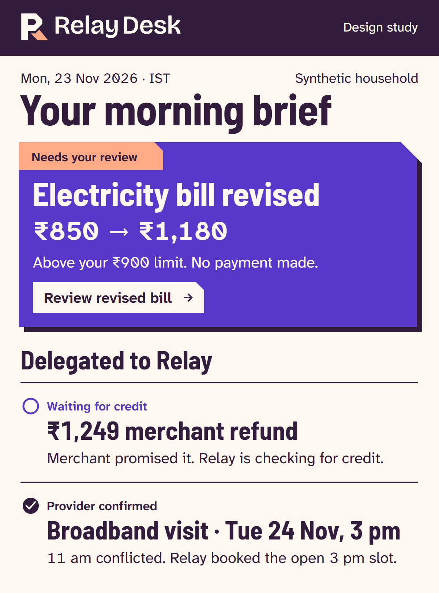

<h1>
  <picture>
    <source media="(prefers-color-scheme: dark)" srcset="docs/brand/wordmark-reversed.svg">
    
  </picture>
</h1>

**“Get my refund back. Book the broadband visit around my calendar. Handle the electricity bill up to ₹900.”**

That is a handoff someone might give an assistant before leaving for work. **Relay Desk** is a proposed personal chief of staff for people who handle that work themselves. It follows each job across messages, calendars and provider records, acts within the permission the person gave it, and brings back the decisions that still need them.

## One decision on Monday morning

In the proposed demonstration, three updates arrive for one synthetic household on **23 November 2026**.

| What comes in | What Relay would take off the person's plate | What counts as done |
| --- | --- | --- |
| A shop promises a **₹1,249 refund**. | Watch for the matching incoming credit. If the agreed checkpoint passes, prepare a specific follow-up for the owner's review. | A posted credit for this return, account, amount and currency. |
| The broadband provider offers **11 am or 3 pm Tuesday**. | Check availability. The morning slot is busy. Book the free 3 pm visit under the existing permission and put it in the calendar. | A provider-confirmed booking and its matching calendar entry. |
| An unpaid electricity invoice changes **from ₹850 to ₹1,180**. | Hold payment. Show exactly what changed and let the person approve this revision once or leave it unpaid. | A matching biller settlement if paid. Tomorrow's standing limit stays ₹900. |

The worked brief assumes the household already set its permissions. A first-time user would review the proposed grants. The evaluation accounts separately for that setup and for later interruptions. [A3 audit](docs/decision.md) · [Household experience](docs/experience.md)

## Give it a job the team never scripted

Ask Relay to track the closure of a library membership. It should agree on the outcome, the membership reference, the library that can confirm closure, and the records it may read. A reply saying “we received your request” keeps the file open. The library's matching closure record finishes it. Tracking the request gives Relay no permission to cancel the membership.

A judge can supply a different goal and issuer after the build is frozen. A new job that fits an existing capability should need no new workflow. If the desk cannot reach the issuer or identify the matching record, it should say what evidence is missing. The original scholarship work remains a specialist example where school and district verification must happen in sequence. [Delegation contracts](docs/architecture.md) · [Scholarship evidence](docs/scholarship-sources.md)

## Project status and materials

**Design proposal for Homingo A3.** The repository contains the audit, build roadmap, visual studies and evaluation protocol. The runnable agent, provider integrations, measured outcomes and submission video are planned. Household records and money in the studies are synthetic. Codex assisted with research, writing and design. The editable visual materials were prepared for Canva. [Official brief](https://hackathon.homingo.co.in/hackathons/edition-01/problem-statements#a3)

- **Understand the problem and evidence.** [Product brief](docs/problem.md) · [Research and provider sources](docs/sources.md)
- **Build the first release.** [Roadmap](roadmap.md) · [First build review](docs/build.md) · [Contributor guide](agents.md)
- **Challenge the proposal.** [Five-slide judge pitch](docs/relay-desk-pitch.pptx) · [Evaluation and baselines](docs/evaluation.md) · [Judge walkthrough](docs/demo.md) · [Submission checklist](docs/hackathon.md)
- **Use the identity.** [Design guide and logos](DESIGN.md) · [Printable identity sheets](docs/brand/identity.pdf) · [Editable identity source](docs/brand/identity.pptx)
