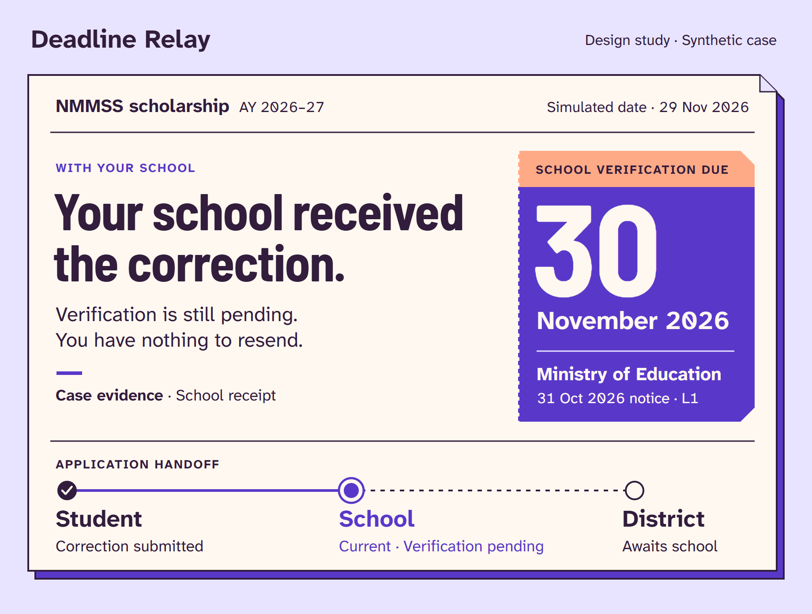

# Deadline Relay

**Your school received the correction. Does that mean your application is verified?**

On 29 November in the proposed demo, a student gets a receipt for the attachment their school asked them to replace. They can put the file away. The school still owes a verification by 30 November. When it verifies, the district takes over with its own 15 December deadline. [Ministry schedule](https://www.pib.gov.in/PressReleasePage.aspx?PRID=2330936&lang=1&reg=3)

Deadline Relay is a proposed personal agent for a family following one already-filed National Means-cum-Merit Scholarship Scheme (NMMSS) application. It follows the handoff across public notices, the student's calendar and the case record. When a family comes back to the case, they should know who has it, what they can do today and which record backs that answer.

The repository contains the design and research for Homingo Hackathon Edition 01, Agents A3. The roadmap sets out how to build, challenge and score the first local demo. [Build roadmap](roadmap.md) · [Official A3 statement](https://hackathon.homingo.co.in/hackathons/edition-01/problem-statements#a3)

## What a judge can change in the planned demo

1. A student has filed their scholarship application and is waiting for school verification. A historical Ministry notice moves the school deadline from **15 November to 30 November** and the district deadline from **30 November to 15 December**. The agent updates the two affected reminders in a real local calendar. A separate calendar entry stays in place. [Earlier Ministry notice](https://www.pib.gov.in/PressReleseDetailm.aspx?PRID=2317657&lang=1&reg=3) · [Revised notice](https://www.pib.gov.in/PressReleasePage.aspx?PRID=2330936&lang=1&reg=3)
2. The judge writes the school's reason for returning the case. “The back page is missing” should give the student a different task from “The copy is unreadable.” If the reason leaves out which page, the agent should help the student ask. After the student records a correction, they can review the exact follow-up and approve it for the local outbox.
3. The school acknowledges receipt. The agent keeps the verification deadline open. The judge can withhold the district’s record after the school verifies. The case must still say who the family is waiting for. Supplying the matching district verification closes the case, with the two officers’ records available for inspection.

The notices are public government records. Every student, status change, correspondence, and calendar entry in the demo is synthetic. The demo uses a historical clock and local services.

## Read the proposal

- **For the family’s experience**, read the worked correction, proposed student sheet and plan to test them with families. [Product brief](docs/problem.md) · [Student experience](docs/experience.md)
- **For the evidence**, follow the four historical schedules, their scope and the reasons for selecting this problem. [Source register](docs/sources.md) · [Decision record](docs/decision.md)
- **For the build**, start with the next milestone, then follow one case from a clean reset. [Roadmap](roadmap.md) · [Build notes](docs/build.md) · [Agent guide](agents.md)
- **For the release decision**, inspect the authority rules, fault cases and matched model comparison. [Architecture](docs/architecture.md) · [Evaluation](docs/evaluation.md)
- **For a judge walkthrough**, use the historical replay, live challenge and recording sequence. [Demo runbook](docs/demo.md) · [Event and submission checklist](docs/hackathon.md)

Codex assisted with research, drafting and the visual study. The runnable agent, evaluation results and demo recording are planned deliverables.
