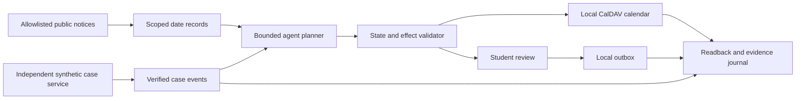

# Architecture

Deadline Relay has two independent kinds of evidence. Ministry notices and the public scholarship listing establish what dates a program publishes. Only case events establish what happened to a particular application. The agent combines the two when planning follow-up. It has no authority to create an institute or district event.

## Public source and case contracts

- **Notice candidate.** A candidate contains scheme, academic year, cohort, geography, milestone, date as published, issuer, issue date or revision when known, and a URL plus a short evidence locator. Keep approved field values and a retrieval hash. Drop page content beyond what is needed to verify the candidate. Interpret a broad heading and its exceptions together. An undated scheme card can corroborate a dated Ministry notice. Any disagreement without a resolved scope or precedence stays visible for review.
- **Confirmed milestone.** Compare issuer revisions within the same scheme, year, cohort, geography and stage. A partial revision replaces only the fields it specifies. A repost or later fetch does not advance the issuer revision. At each replay step, use dated releases published by that day and undated snapshots captured by that day. This first makes the 21 November portal capture available on 21 November. A same-scope conflict holds the affected milestone at its last confirmed value until resolved. Keep the source and date for each field. Preserve date-only evidence as an Indian calendar date, with any advance reminder stored separately. [Historical source register](sources.md#nmmss-timeline)
- **Case event.** Each event carries a stable event ID, case ID, per-case sequence assigned by the simulator, issuer role, type, stage, receipt reference and recorded time. The institute's return event ID identifies one correction request. Every correction submission or acknowledgement cites that return, and acknowledgement also cites the submission. A subsequent return starts a fresh request with its own reason and invalidates any outstanding draft for the previous request.
- **Plan.** A typed plan contains the goal, current case sequence, evidence versions, proposed calendar or outbox actions, and a terminal reason. The model chooses which tools to call, interprets public notice variants, and composes a case-specific next action. The controller validates dates, permitted targets and state transitions before effects. Captured data and provider records determine completion.

## Wait states and independent proof

| Receipt from the case simulator | Required context | What the student sees next |
| --- | --- | --- |
| Student filing recorded, `submitted` | New case | The institute owns L1. Show its published deadline and the evidence still due. |
| Institute requests a correction, `returned_for_correction` | L1 pending | The student owns the requested correction. Quote the reason, pause institute nudges and label the L1 date as the institute's deadline. |
| Student resubmits, `correction_submitted` | Current return, student action in simulator | The institute owns re-review. Offer one draft asking it to confirm receipt while acknowledgement is outstanding. |
| Institute acknowledges, `correction_acknowledged` | Submission for the current return | Show the receipt, withdraw an unqueued receipt request and keep L1 pending. Any previously queued request stays in history. |
| Institute verifies, `institute_verified` | L1 pending with any current correction resubmitted | The district owns L2. The institute can verify directly after resubmission even when it issued no separate acknowledgement. |
| District verifies, `district_verified` | Valid L1 verification for this case | Show both authority receipts and close the verification follow-up. Scholarship award and payment are outside the observed outcome. |

Fold the contiguous case stream in service sequence. Duplicate deliveries of the same record have no effect. A gap triggers a reread from the last accepted sequence and holds case-dependent actions until the gap is filled. A late acknowledgement for a superseded return is historical evidence only. An event with conflicting contents under the same ID or sequence, or a transition the designated authority could not make at that stage, leaves the last verified owner visible with a review reason. A deadline change can update an open reminder at any point in this flow. It cannot assign a new case owner or reopen a completed stage.

## Tool and write boundaries

- **Read tools.** `fetch_notice` reads a registered public source or its labeled historical capture. `read_case`, `read_calendar` and `lookup_outbox` return the corresponding local records. Only simulator controls can issue case receipts. In live-model mode the configured inference endpoint receives selected public excerpts and synthetic case context. Fixture replay works offline. Keep account credentials, student files and identifying details out of both modes.
- **Calendar.** Authorize changes only to this case's two managed stage events in the isolated calendar. Give each one a stable UID and resource path. Create conditionally at that path, update against its last observed ETag and record the old and proposed date. Store the deadline as an all-day date. Retire an active reminder on verification and preserve the stage history. An extension affects open stages. A calendar edit or deletion by the student puts the affected event into review. [Radicale](https://radicale.org/) · [CalDAV](https://www.rfc-editor.org/rfc/rfc4791) · [iCalendar](https://www.rfc-editor.org/rfc/rfc5545)
- **Approval.** Show the local recipient, subject and full body. Bind the decision to those exact values, the draft revision, the case sequence, the return event ID and the revisions of any deadline fields used in the draft. Serialize notice processing, draft edits and approvals in the one local controller. A changed dependency invalidates an outstanding approval. Declining leaves the draft unqueued.
- **Outbox.** Place the sandbox outbox in a separate table alongside the simulator timeline so the queue writer can compare the expected case sequence and insert the approved payload in one SQLite transaction. Give it a distinct endpoint that can only stage a message. Use a unique key built from case, return event and follow-up purpose. Two clicks or a retry after a lost response can produce just one row for that request. Look up an existing row before retrying and compare its payload and approval receipt. A mismatch requires review. The case event stream, queue row and agent journal remain separately inspectable.

For each calendar write, first journal the intent and the starting ETag, then read back the expected UID, date and other managed fields. After a lost response, a matching readback verifies the effect. If the original version is intact, retry the same conditional operation only while its intent is still current. An unexpected version goes to review. Track L1 and L2 writes individually. If only one succeeds, show which date reached the calendar and which still needs attention.

## Failure behavior

Wake on a newly available source version, a case event or a scheduled checkpoint with a stable ID. Save the input identity, case sequence, source revisions and validated plan before dispatch. Duplicate deliveries reuse that decision. After an interruption, resume pending effects from the journal. A readback or conditional retry may still be necessary. An overdue checkpoint changes the displayed urgency once and records which authority receipt is still due.

Store the time of the last successful case read separately from the time of the last case event. At a student's scheduled check, read from the last accepted sequence through the service's current sequence. A successful read with zero new records advances the checked time and keeps the same owner. A failed read or an expired checkpoint leaves the checked time unchanged. Show the last evidenced owner, receipt time and last successful check. Offer a manual retry after at most one automatic retry for that checkpoint. A suggested question to ask the school in person is display-only.

During a case-feed outage, keep resolving and displaying public deadline revisions. Hold any case-dependent write whose stage or approval could have gone stale. On recovery, reread the case stream first, retire obsolete drafts and reconcile each still-open reminder against the latest public date. A repeated checkpoint cannot queue a follow-up or revive a completed stage.

Treat instructions inside a notice or free-text message as quoted material. A proposed fact needs an available source and a matching passage. Tool permission, evidence precedence, approval and case transitions belong to the deterministic controller. Set a finite model-call and tool budget per wake. On timeout, malformed output or exhausted budget, display the last confirmed handoff and a retry option. A failed interpretation authorizes zero new effects. Cached public evidence carries its capture date and source link.
