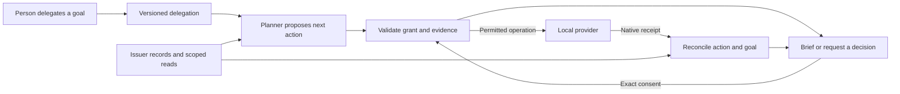

# How Relay Desk carries a delegation

A person hands over a goal, decides what Relay may do for them and agrees what evidence will settle it. One desk can carry a refund, an appointment and a bill while their owners, permissions and proof stay separate. This document specifies the proposed local simulator.

## One delegation record

| Field | What the desk must know |
| --- | --- |
| Goal and scope | A user-confirmed outcome, a stable delegation ID and the subject reference, such as one order or invoice. Record the current revision. |
| Owner and next action | The person, Relay or third party who owes the next step, what would change the owner, and the last receipt supporting that assignment. |
| Time | Due date or time with its source, precision and applicable zone. Store the next check separately. A requested check date can exist even when the external deadline is unknown. |
| Permission envelope | Permitted reads and writes by tool, purpose, subject, destination, expiry and maximum count. Specify which effects need exact approval. For spending, scope the currency, payee and cap. Every provider read or write needs a matching active grant. |
| Authority and terminal proof | Name the trusted issuer and the record type, subject, status and required matching fields that together establish completion. A multi-step goal can require more than one receipt. Preserve the native record IDs and revisions. |
| Current evidence | Keep the last successful check per source, last observed event, outstanding question, pending operation and any verified outcome. Stopping or revoking a delegation records why tracking ended. Only satisfying the proof rule earns **Verified**. |

For a new kind of task, the person can choose a registered evidence source and supply its typed receipt fields through the same intake. The rule evaluator supports equality on named fields and conjunctions of receipts. The planner can propose a rule for confirmation. Only the user can expand the grant or change the required proof. When the requested evidence source is unavailable or outside the supported capabilities, retain the goal, owner and check date with **Evidence needed**. The user can delegate the follow-through without adding a connector or inventing a completion signal.

On a cold start, the spoken handoff creates three proposed goals. Show the owner which source and fields each job needs and which actions would become possible. Let them grant, narrow or decline each scope independently. Access to free/busy alone permits neither booking nor a calendar write. A declined ledger read leaves refund verification unavailable while a separately authorized booking can proceed. The Monday one-decision brief assumes these choices were made earlier and all three grants are still current.

## What counts as done

| Delegation | Work permitted in the local fixture | Terminal proof |
| --- | --- | --- |
| Recover a ₹1,249 refund | Check the merchant record and a scoped settlement feed. Prepare one follow-up. Queue the exact message after approval. | A posted incoming credit for the same refund reference, ledger account, currency and expected amount. A merchant promise, pending credit or partial amount keeps the balance open. |
| Book a free broadband service visit | On 23 Nov 2026 IST, check the provider and the household's free/busy intervals for Tue 24 Nov. The 11 am slot is busy and outside the granted afternoon window. The free 3 pm slot fits the user's one-visit grant, so Relay can book it without interrupting them. | Read the provider's confirmed reservation for the right service, subject and slot. Then read back the matching managed calendar event. With a confirmed booking and failed calendar sync, report both facts and recover the calendar entry. |
| Pay an electricity bill | A revision from ₹850 to ₹1,180 breaks the ₹900 standing cap. Pause payment. The person may leave it unpaid or approve one exact exception for that invoice revision. | The fixture biller's settled receipt matched to invoice, payee, amount, currency and payment reference. A debit accepted for processing can leave the bill open. The ₹900 standing cap continues to govern later bills. |
| Follow a new request | Capture the user's outcome, the actor, the permitted reads and the evidence their chosen issuer can provide. Start with tracking and a check date. | Apply the user-confirmed receipt rule through the generic evidence reader. A friendly reply or self-reported progress leaves the task open when formal proof is due. |

If two systems use different identifiers, require an issuer record that explicitly links them. A single credit with the right amount and date can still belong to another return. Show **Credit found · return unconfirmed** until a permitted source supplies the link. The person may stop tracking while the evidence status stays unresolved.

## The brief

Recompute the brief from current evidence on each wake. Put actionable exceptions first. A changed payee or newly conflicting appointment calls for a decision. Next show user work due before the next check, then work waiting on someone else. Sort ties by earliest applicable deadline and stable delegation ID, placing unknown deadlines last within their group. Put recent verified outcomes in a separate receipt history. Each row gives the owner, change, required decision or next check, and a direct path to its evidence. Group repeated events for the same issue into one decision. A quiet, reachable provider with no new records produces no new interruption.

## Who may write

Register each tool with its issuer, permitted operations, native record identity, freshness field and readback method. The planner can interpret mail or propose an action. Only a deterministic controller holding the person's current grant can dispatch it. A quoted request, merchant message or change in urgency cannot add a destination, identify a new payee as trusted or expand a spending limit.

- **Messages.** Read only the scoped thread. Stage one exact recipient, subject and body in the local outbox after review. Any edit or superseding receipt retires the approval. A queue row proves the local write.
- **Appointments.** Consent may cover one service, provider, window, zone and price. The local fixture can check both free/busy and slot versions when it commits a reservation. Separate live services can change between calls. After booking confirmation, reread free/busy before recording the visit. If a new conflict appears then or at a later check, show **Visit booked · calendar conflict** with both times. Preserve the provider reservation and the household event. Offer to keep the booking or review a change with its current terms. Cancellation, rescheduling or accepting an overlap needs the owner's explicit choice. Reconcile the original booking ID once per retry checkpoint. A persistent conflict waits for the person.
- **Bills.** Scope each grant to its payee identity, currency, amount ceiling and maximum count. Recheck the invoice revision at execution. An amount or payee change retires any approval for the old terms. A new payee requires new consent even below the old cap. Bind a one-off exception to the displayed invoice, payee, currency and exact amount, and consume it once. Recheck and consume any shared budget inside the same transaction as the synthetic payment. Keep the standing cap intact.
- **Revocation.** Show the person what work is pending and what has already committed. Revoking increments the grant revision and stops new checks, drafts and writes under it. Check that revision at the provider commit boundary. If a write won the race, display its existing receipt and explain what took effect. When access also prevents readback, preserve **Outcome unknown** until the person can reconcile it.

Use one local fixture service with separate issuer controls, provider tables and read-only inspection. Keep the planner journal separate. Record intent before dispatch, use a stable operation key per delegation and logical action, then reconcile the authoritative row. A retry must recover the same receipt, slot or payment even after midnight or a restart. Resolve an unknown prior outcome before trying a substitute. A provider revision mismatch, duplicate key with a different payload, incomplete sequence or stale read holds the affected action for review. An unrelated delegation can continue.

## Quiet work and missing evidence

Wake on a new issuer record, a user decision or a scheduled checkpoint. Deduplicate by source and record version before calling a model. At each check record the latest event time and the last successful read separately. A reachable provider with zero changes advances the checked time. A failed read leaves it intact and keeps the last evidenced owner visible. Permit one automatic retry per checkpoint, then offer a manual retry. Deadline passage raises urgency. Only the declared proof changes verification.

Use stable synthetic references and the smallest fields needed to match a receipt. The booking service needs free/busy intervals, service, slot and zone. The refund reader needs a scoped credit reference and amount. A billing read needs the invoice identity, payee, amount, currency and revision. Free/busy inspection does not require calendar titles or attendees. Limit any live-model prompt to the necessary redacted excerpts. Keep credentials, real account identifiers and unrelated household records out of fixtures, logs and model context. The fixture-driven path uses local services.

## Scholarship regression

An already-filed NMMSS application adds scope-aware public deadlines and two sequential authorities. Preserve the historical replay clock, independent calendar UIDs and correction-request IDs. A school return passes the task to the student. Submission of the correction returns it to the school. Acknowledgement settles receipt. The institute's verification passes the case to the district. Only the district's own matching verification completes the two-stage goal. A disconnected case feed can leave a school reminder waiting for reconciliation while public dates continue to update.

The original specification at commit `e7b729d` defines the state table, CalDAV preconditions and recovery variants for this extension. [Scholarship source register](scholarship-sources.md) · [Pinned school architecture](https://github.com/JunaidAhamed-7777/relay-desk/blob/e7b729d64489d5622118d55c8d9664f35bf3a9f0/docs/architecture.md)
