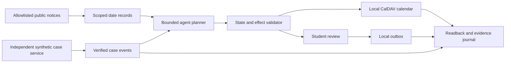

# Architecture

Deadline Relay has two independent kinds of evidence. Ministry notices and the public scholarship listing establish what dates a program publishes. Only case events establish what happened to a particular application. The agent combines the two when planning follow-up. It has no authority to create an institute or district event.

## Public source and case contracts

- **Notice candidate.** A candidate contains scheme, academic year, cohort, geography, milestone, date as published, issuer, issue date or revision when known, and a URL plus a short evidence locator. Keep approved field values and a retrieval hash. Drop page content beyond what is needed to verify the candidate. Interpret a broad heading and its exceptions together. An undated scheme card can corroborate a dated Ministry notice. Any disagreement without a resolved scope or precedence stays visible for review.
- **Confirmed milestone.** Resolve only within the same scope. A later authorized revision may replace one or multiple stages. Unrelated schemes, years and cohorts stay independent. If a source has only one date, preserve dates for other stages until specifically revised. Date-only evidence stays date-only in IST. The calendar can use a separate user-selected advance reminder. Never manufacture a cutoff time or a relationship such as `application date + 30 days`.
- **Case event.** Every synthetic event has an ID, case ID, monotonically increasing service sequence, actor role, type, receipt reference and recorded time. The simulator’s independent role paths emit `submitted`, `returned_for_correction`, `correction_submitted`, `correction_acknowledged`, `institute_verified`, and `district_verified`. Verify issuer role, stage and correlation before advancing. Retain repeated event identity and gap state for recovery.
- **Plan.** A typed plan contains the goal, current case sequence, evidence versions, proposed calendar or outbox actions, and a terminal reason. The model chooses which tools to call, interprets public notice variants, and composes a case-specific next action. The controller validates dates, permitted targets and state transitions before effects. Captured data and provider records determine completion.

## Wait states and independent proof

| Observed event | Owner and next case state |
| --- | --- |
| `submitted` | Institute owns verification. The student can track or request follow-up. |
| `returned_for_correction` | Student owns the correction. Pause routine institute nudges and preserve the actual notice reason. |
| `correction_submitted` | Institute owns re-review. Prepare a local follow-up when the policy calls for one. |
| `correction_acknowledged` | Institute still owns verification. Acknowledgement can prevent a redundant reminder to confirm receipt. |
| `institute_verified` | District owns verification. Retire the institute task and surface the district deadline. |
| `district_verified` | Close only when the same case has a valid institute verification and district verification at the expected stage. |

Unsupported events, out-of-order service records, or discrepancies in case identity require a reread or a human handoff. A late response should never rewrite a newer state. A terminal rejection, if modelled, remains an external decision and routes to human review.

## Tool and write boundaries

- **Read tools.** `fetch_notice` accepts registered public URLs only. `read_case` returns the simulator timeline and source references. `read_calendar` and `lookup_outbox` return the agent-owned local state and existing receipt IDs. No government login, student uploads, addresses, or real email transport is part of the demo.
- **Calendar.** Local Radicale gives the judge a separate server to verify actual writes. Use a stable VEVENT UID per synthetic case, stage and reminder purpose. Use ETags for conditional updates and `SEQUENCE` for significant revisions. Keep known versions in a journal, retry the same UID after interrupted responses, and preserve unrelated or user-edited records. If reconciliation is ambiguous, mark the stale reminder and ask the student rather than overwriting it. [Radicale](https://radicale.org/) · [CalDAV](https://www.rfc-editor.org/rfc/rfc4791) · [iCalendar UID and sequence](https://www.rfc-editor.org/rfc/rfc5545)
- **Outbox.** Generate the target role, exact content and effect from verified case context, then present them for human approval. The local controller binds approval to the case sequence and exact draft hash. If the approval or case is stale, require review of the new draft. Use a unique operation key and one SQLite transaction to store the local message effect and receipt. The model can propose drafts. Simulator roles and the approved writer use separate controls.
- **Calendar and outbox are independently reconciled.** Journal intention before a write, read the result from the service, and avoid duplicate effects after a restart. A database entry can say which effect is pending or verified. Cross-service completion comes from independent readback, and a verified write implies only that its own service performed it.

## Failure behavior

Pending cases wake on a new verified source version, simulator event, or uniquely keyed user checkpoint. Duplicate input events and repeated reads of the same source version cause zero new model calls or side effects. A bounded timer and retry policy cap follow-up. The model uses a fixed tool budget per wake. Absent or conflicting official evidence stops deadline rewrites. Unknown provider outcomes are reconciled before another operation is attempted. Display the last verified source and pending effects so the operator can act without guessing.
