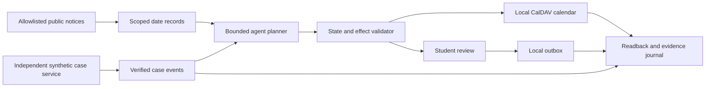

# Architecture

Deadline Relay has two independent kinds of evidence. Ministry notices and the public scholarship listing establish what dates a program publishes. Only case events establish what happened to a particular application. The agent combines the two when planning follow-up. It has no authority to create an institute or district event.

## Public source and case contracts

- **Notice candidate.** A candidate contains scheme, academic year, cohort, geography, milestone, date as published, issuer, issue date or revision when known, and a URL plus a short evidence locator. Keep approved field values and a retrieval hash. Drop page content beyond what is needed to verify the candidate. Interpret a broad heading and its exceptions together. An undated scheme card can corroborate a dated Ministry notice. Any disagreement without a resolved scope or precedence stays visible for review.
- **Confirmed milestone.** Compare issuer revisions within the same scheme, year, cohort, geography and stage. A partial revision replaces only the fields it specifies. A repost or later fetch does not advance the issuer revision. At each replay step, use dated releases published by that day and undated snapshots captured by that day. This first makes the 21 November portal capture available on 21 November. A same-scope conflict holds the affected milestone at its last confirmed value until resolved. Keep the source and date for each field. Preserve date-only evidence as an Indian calendar date, with any advance reminder stored separately. [Historical source register](sources.md#nmmss-timeline)
- **Case event.** Each event carries a stable event ID, case ID, per-case sequence assigned by the simulator, issuer role, type, stage, receipt reference and recorded time. The institute's return event ID identifies one correction request. Every correction submission or acknowledgement cites that return, and acknowledgement also cites the submission. A subsequent return starts a fresh request with its own reason and invalidates any outstanding draft for the previous request.
- **Plan.** A typed plan contains the goal, current case sequence, evidence versions, proposed calendar or outbox actions, and a terminal reason. The model chooses which tools to call, interprets public notice variants, and composes a case-specific next action. The controller validates dates, permitted targets and state transitions before effects. Captured data and provider records determine completion.

## Wait states and independent proof

| Receipt from the case simulator | Required context | What the student sees next |
| --- | --- | --- |
| Student filing recorded, `submitted` | New case | The institute owns L1. Show its published deadline and the evidence still due. |
| Institute requests a correction, `returned_for_correction` | L1 pending | The student owns the requested correction. Quote the reason, pause institute nudges and label the L1 date as the institute's deadline. |
| Student resubmits, `correction_submitted` | Current return, student action in simulator | The institute owns re-review. Offer one draft asking it to confirm receipt while acknowledgement is outstanding. |
| Institute acknowledges, `correction_acknowledged` | Submission for the current return | Show the receipt, withdraw an unqueued receipt request and keep L1 pending. Any previously queued request stays in history. |
| Institute verifies, `institute_verified` | L1 pending with any current correction resubmitted | The district owns L2. The institute can verify directly after resubmission even when it issued no separate acknowledgement. |
| District verifies, `district_verified` | Valid L1 verification for this case | Show both authority receipts and close the verification follow-up. Scholarship award and payment are outside the observed outcome. |

Fold the contiguous case stream in service sequence. Duplicate deliveries of the same record have no effect. A gap triggers a reread from the last accepted sequence and holds case-dependent actions until the gap is filled. A late acknowledgement for a superseded return is historical evidence only. An event with conflicting contents under the same ID or sequence, or a transition the designated authority could not make at that stage, leaves the last verified owner visible with a review reason. A deadline change can update an open reminder at any point in this flow. It cannot assign a new case owner or reopen a completed stage.

## Tool and write boundaries

- **Read tools.** `fetch_notice` accepts registered public URLs only. `read_case` returns the simulator timeline and source references. `read_calendar` and `lookup_outbox` return the agent-owned local state and existing receipt IDs. No government login, student uploads, addresses, or real email transport is part of the demo.
- **Calendar.** Local Radicale gives the judge a separate server to verify actual writes. Use a stable VEVENT UID per synthetic case, stage and reminder purpose. Use ETags for conditional updates and `SEQUENCE` for significant revisions. Keep known versions in a journal, retry the same UID after interrupted responses, and preserve unrelated or user-edited records. If reconciliation is ambiguous, mark the stale reminder and ask the student rather than overwriting it. [Radicale](https://radicale.org/) · [CalDAV](https://www.rfc-editor.org/rfc/rfc4791) · [iCalendar UID and sequence](https://www.rfc-editor.org/rfc/rfc5545)
- **Outbox.** Generate the target role, exact content and effect from verified case context, then present them for human approval. The local controller binds approval to the case sequence and exact draft hash. If the approval or case is stale, require review of the new draft. Use a unique operation key and one SQLite transaction to store the local message effect and receipt. The model can propose drafts. Simulator roles and the approved writer use separate controls.
- **Calendar and outbox are independently reconciled.** Journal intention before a write, read the result from the service, and avoid duplicate effects after a restart. A database entry can say which effect is pending or verified. Cross-service completion comes from independent readback, and a verified write implies only that its own service performed it.

## Failure behavior

Pending cases wake on a new verified source version, simulator event, or uniquely keyed user checkpoint. Duplicate input events and repeated reads of the same source version cause zero new model calls or side effects. A bounded timer and retry policy cap follow-up. The model uses a fixed tool budget per wake. Absent or conflicting official evidence stops deadline rewrites. Unknown provider outcomes are reconciled before another operation is attempted. Display the last verified source and pending effects so the operator can act without guessing.
