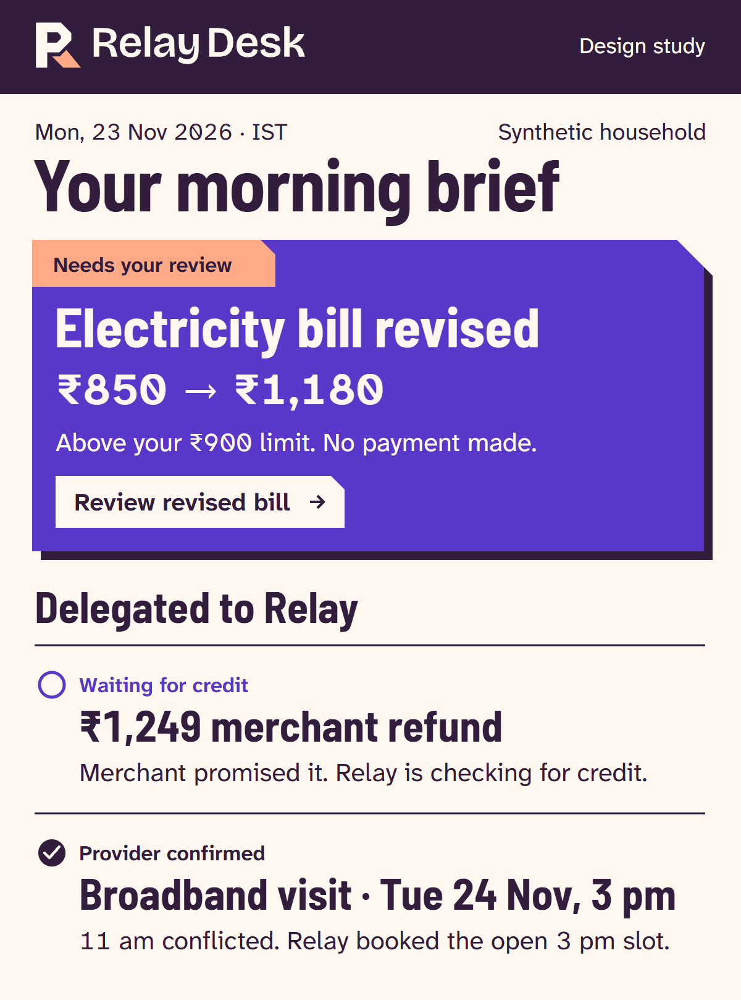

# From one errand to a daily brief

## First use on a phone

Open with **What would you like help following up on?** Give the person one text field. “The shop said it would refund me. Can you help me check on Friday?” is enough to start. They can also paste a short message, removing anything they prefer to keep private. Let them read and edit that excerpt before saving it. Tell them what will be kept with the errand.

Show what Relay understood in ordinary language. If Friday is ambiguous, ask which date they meant. The first confirmation could read like this.

> **Check for my refund on Friday**
>
> You wrote that the shop promised a refund. When you come back on Friday, check whether the money has arrived.
>
> **Save this errand** · Edit

Saving gives the person an open errand, the next check they chose and the message they agreed to keep. On Friday, the brief can offer “Look for the credit for this return” and a question to ask the shop if it is missing. Someone who chooses to stop tracking can do so without proving the refund. The history should distinguish that choice from a verified credit.

Offer a permitted account check only when it would help and the service supports it. Explain exactly which record Relay would read and let the person continue checking for themselves. Until a permitted source supplies the matching credit, the screen should say what still needs checking. Typing a request or pasting a shop message grants no inbox, bank or payment access. A person can keep using the single errand this way.

## Monday morning

The fuller brief below shows a later session. The person has separately arranged a scoped refund lookup, a free visit in a particular window and bill payment for one payee up to a set amount. Those choices are part of setup. Only the revised bill needs a new decision in this example.

**Review revised bill** opens the earlier and current invoices side by side. Show the payee, account reference, dates and amount for each. Put the person’s standing ₹900 limit immediately below the new ₹1,180 total. Explain that the decision applies to this version of this invoice. Present **Pay ₹1,180 once** and **Leave unpaid**. Choosing the one-time exception authorizes the local simulator to pay that version, and the ₹900 standing limit still applies to the next bill.

After approval, show the local payment action and its status. If the payment service loses its response, say **Checking whether the payment went through** and check the existing operation. Mark the bill settled only after reading a matching settlement receipt. A new invoice revision during review retires the old decision and shows what changed. Deferring the bill returns the person to the brief without prompting again on every refresh.

## What the desk can take care of with permission

| Errand | What the person sees today | What counts as proof |
| --- | --- | --- |
| Recover the **₹1,249 merchant refund** | **Waiting for credit.** Open the merchant’s promise, the last check of the authorized account and the next agreed checkpoint. If it passes, offer a follow-up for review. | A posted incoming credit on the scoped account matching the amount, currency and return reference. A credit of the same amount for another return leaves this case open. |
| Arrange **one free Tuesday afternoon broadband visit** | **Booked for Tue 24 Nov, 3 pm.** The 11 am offer overlapped a household commitment. The permitted 3 pm booking has a provider confirmation and a calendar entry. | The provider’s confirmed booking for the correct service, date, time and zone. Show calendar readback separately. If the booking is confirmed but the calendar is unavailable, keep the booking and disclose the calendar problem. |
| Pay the **electricity account within ₹900** | **Needs your review.** The original ₹850 invoice was replaced by ₹1,180 before any payment. Hold the payment while waiting for the owner’s decision. | A settled receipt matching the exact invoice, payee, currency and amount authorized for that payment. |

Relay can keep working on the refund and booking while the person considers the bill. Open any item to see the original request, the permission given, who acts next, the next check and the source record. Keep a missed check with its errand and distinguish the last successful check from the last event. If the source is unavailable, say **The last account check was Monday. Relay couldn’t check for a newer credit.** A successful check that found nothing new can show when it happened. [Delegation and evidence contracts](architecture.md)

## Giving Relay a new job

The same intake works for the next errand. For a broadband visit, ask for permission to read the relevant free/busy times, reserve a visit and add the confirmed booking to the calendar. Show the terms **One appointment · Tuesday afternoon · Free · Keep existing commitments**. A person can decline booking access and consider the offers themselves. If the remaining offers all require a fee, a different day or moving an event, Relay returns with those specific choices.

For unfamiliar work, ask only for details needed for the next step. “Watch for my old library membership to close” can start as an open errand. To verify it later, Relay needs a membership reference and a permitted source that can confirm closure. An acknowledgement leaves the case open. A person can inspect or withdraw a permission at any time. Withdrawing it stops future actions under that permission and preserves the history of receipts already recorded.

When a household commitment overlaps an already confirmed provider visit, the person can take over rescheduling or ask Relay to keep checking the interval. Their choice applies to the displayed booking and overlap. The booking stays open until its own confirmation and calendar entry can be verified. [Reproduce the conflict](demo.md#let-the-judge-break-the-plan)

## A briefing that works on a phone

Lead with the decision, the previous value, the new value and the person’s rule. Put completed or waiting work beneath it. Use a text label with every status symbol. Keep the decision visible until resolved or deferred, and leave evidence accessible from each item. Use the carbon-copy receipt treatment for the decision and save the melon tab for a genuine exception. [Identity system](../DESIGN.md)

At 320 CSS pixels, stack the revised amount, permission and choices in reading order. Give controls visible keyboard focus and touch targets of at least 44 by 44 CSS pixels. Opening a decision places focus at the invoice heading. Closing it returns focus to the invoking control, or to the updated briefing when that control retires. New receipts announce once without stealing focus. Reduced-motion mode updates the text and state immediately.

Test saving the first errand with keyboard navigation and at 200% text zoom. Check that the person can edit the message, decline account access and still find their next check. Then use the synthetic Monday brief to test whether they can find the missing refund evidence and explain what paying this bill does to their next limit. Record where they hesitated or needed help. These checks are proposed. The artwork is a design study. [Participant session worksheet](participant-session.md) · [Evaluation plan](evaluation.md)
